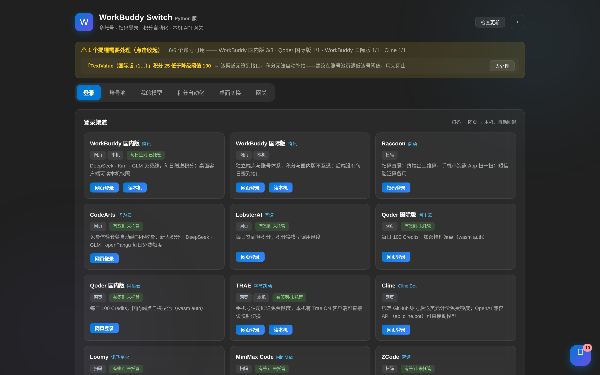
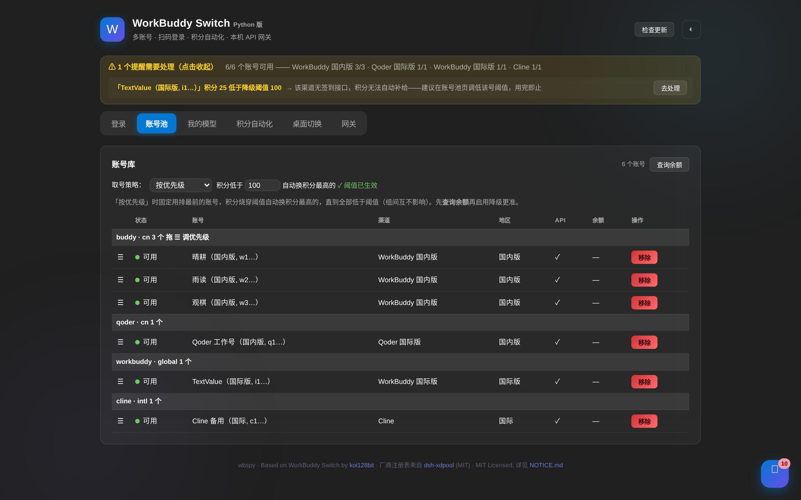
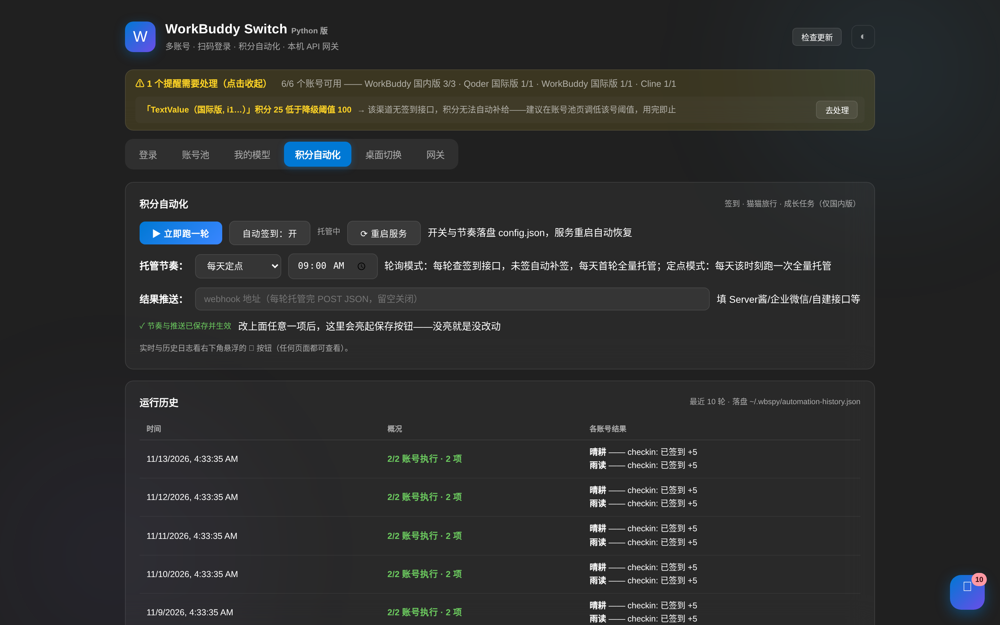
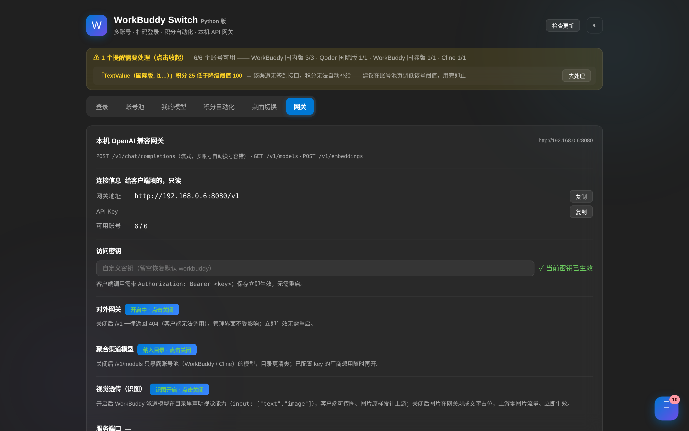

# WorkBuddy Switch (Python) — wbspy

[](https://github.com/yingfing/workbuddy-switch-python/releases/latest)
[](https://github.com/yingfing/workbuddy-switch-python/releases/latest)
[](https://github.com/yingfing/workbuddy-switch-python)
[](https://github.com/yingfing/workbuddy-switch-python/actions/workflows/ci.yml)
[](LICENSE)

[中文说明](README.md) | **English**

A self-hosted, **OpenAI-compatible API gateway** that unifies your AI accounts and free-tier credits behind one endpoint — plus multi-account switching, protocol-level QR login for 13 AI providers, and fully automated daily check-ins (streaks, tasks, lottery, pet adventure) for WorkBuddy CN.

> **Clone once, run anywhere**: pure Python, zero compilation, zero external services, Python 3.9–3.13. Ships as a single executable for Windows / Linux / macOS.
>
> Based on [WorkBuddy Switch](https://github.com/koi128bit/WorkBuddy-Switch) by koi128bit. Provider registry from [dsh-xdpool](https://www.npmjs.com/package/dsh-xdpool) (MIT).

## Why

Free AI credits are scattered across a dozen Chinese AI providers (DeepSeek, Kimi, GLM, MiniMax, Qwen, Hunyuan…) — each with its own login, its own daily check-in, its own API. **wbspy collects them all into one local gateway**, so any OpenAI SDK client (including Claude Code, Cline, LobeChat, anything speaking `/v1/chat/completions`) can use the whole free pool with automatic failover.

## Install (pick your platform)

| Platform | Method | Command |
|---|---|---|
| **Windows** | Standalone exe | Download `wbspy.exe` from [Releases](https://github.com/yingfing/workbuddy-switch-python/releases/latest), then `wbspy.exe web` |
| **Linux** | AppImage | `chmod +x wbspy-linux-x86_64.AppImage && ./wbspy-linux-x86_64.AppImage web` |
| **macOS** | Single binary | `chmod +x wbspy-macos-arm64 && ./wbspy-macos-arm64 web` (Intel: `x86_64`) |
| **pip** | Any OS | `pip install . && wbspy web` |
| **From source** | Clone & run | `git clone https://github.com/yingfing/workbuddy-switch-python.git && cd workbuddy-switch-python && pip install -e . && wbspy web` |
| **Docker** | Container | `docker compose up -d` |

Then open `http://127.0.0.1:8178` — everything else (login, check-ins, gateway) is point-and-click.

## Features

| | |
|---|---|
| **Multi-account switch** | Snapshot & restore desktop-client logins instantly; auto-backup before switching |
| **13 login providers** | WorkBuddy CN/Global, Raccoon, MiniMax, Cline, Loomy, Qoder CN/Intl, CodeArts, TRAE, LobsterAI, ZCode, Gemini — real protocol implementations with QR / web / local-credential fallback |
| **Auto check-in bot** | Daily sign-in, growth tasks, streak redemption, lucky lottery, pet adoption & adventure, makeup cards — one run covers everything |
| **Unified gateway** | OpenAI-compatible `/v1/chat/completions` across 76 providers / 470+ free models; account pool rotation, per-error cooldown, cross-provider failover, streaming & non-streaming |
| **Web console** | QR login, account pool, model catalog, automation logs, usage stats; Fluent-style dark/light themes |
| **Self-update** | `wbspy update` checks GitHub releases; on CN networks it automatically falls back Aliyun DoH → Google DoH → curated IPs |

## Screenshots

| | |
|---|---|
| [](docs/screenshots/login.png) | [](docs/screenshots/accounts.png) |
| [](docs/screenshots/auto.png) | [](docs/screenshots/gateway.png) |

*Login provider wall · account pool (priority strategy + health overview) · automation bot (schedule + run history) · OpenAI-compatible gateway. Captured with demo data.*

## Quick start

```bash
wbspy web          # Web console + gateway (same port)
wbspy login buddy  # CLI login (QR first)
wbspy checkin      # run one automation round now
wbspy auto         # schedule daily automation
wbspy quota        # show credits per account
wbspy update       # check for new release
```

Gateway usage (point any OpenAI client at it):

```bash
curl http://127.0.0.1:8178/v1/chat/completions \
  -H "Content-Type: application/json" \
  -d '{"model": "deepseek-chat", "messages": [{"role": "user", "content": "hello"}]}'
```

## Requirements

- Python 3.9+ (runs on armv7 boards like the OneCloud with `apt install python3` — no compiled deps)
- ~50 MB RAM, < 20 MB disk

## Self-hosting

```bash
git clone https://github.com/yingfing/workbuddy-switch-python.git && cd workbuddy-switch-python
pip install -e .
wbspy web --port 8178     # or: docker compose up -d
```

For systemd / public deployment / account migration, see the [Chinese README](README.md#部署方式).

## Releases

Built automatically by GitHub Actions on every version bump — each release ships `wbspy.exe` (Windows), `wbspy-linux-x86_64.AppImage`, and macOS binaries (arm64 / x86_64) with per-platform install commands.

## Disclaimer

This project manages **your own** accounts and aggregates free tiers only. No cracking, no paywall bypass, no bulk registration. Use at your own risk and comply with each provider's terms.

## License

MIT — see [LICENSE](LICENSE) / [NOTICE.md](NOTICE.md)
