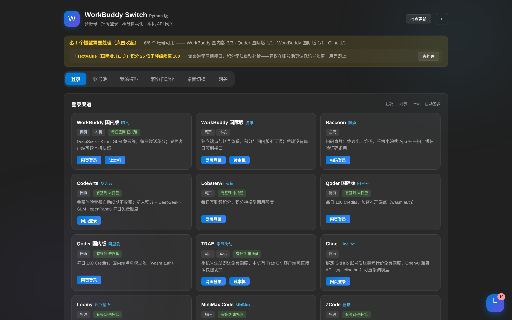
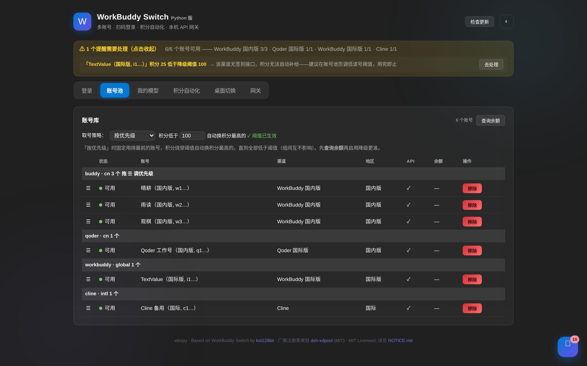
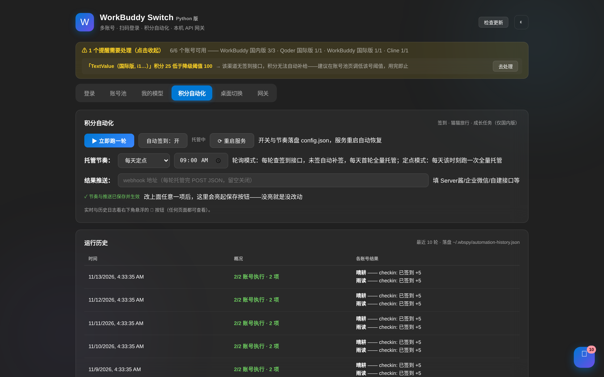
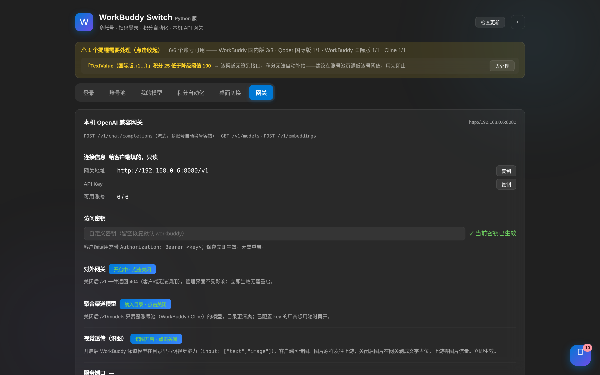
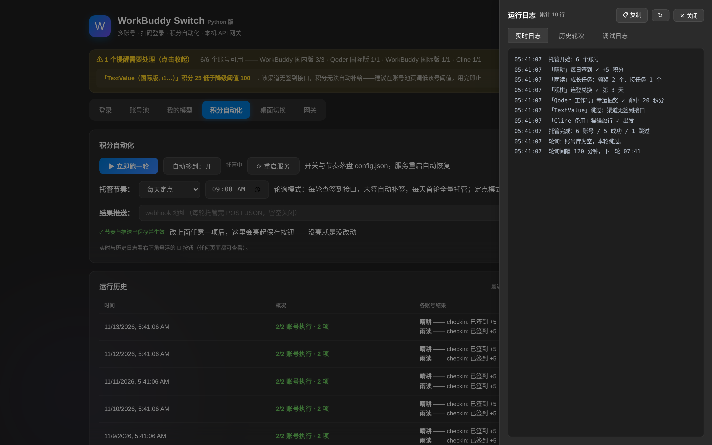

# WorkBuddy Switch (Python) — wbspy

[](https://github.com/yingfing/workbuddy-switch-python/releases/latest)
[](https://github.com/yingfing/workbuddy-switch-python/releases/latest)
[](https://github.com/yingfing/workbuddy-switch-python)
[](https://github.com/yingfing/workbuddy-switch-python/actions/workflows/ci.yml)
[](LICENSE)

**[English](README.en.md)** | 简体中文

> 多账号切换 · 13 家渠道扫码登录 · 积分自动托管（签到/猫猫旅行/任务）· 统一 OpenAI 兼容网关（76 家厂商 470+ 免费模型）
>
> **一次克隆，三端运行**：纯 Python 实现、零编译、零外部服务，3.9~3.13 全兼容。
> 基于 [WorkBuddy Switch](https://github.com/koi128bit/WorkBuddy-Switch) by koi128bit ·
> 厂商注册表来自 [dsh-xdpool](https://www.npmjs.com/package/dsh-xdpool)（MIT）

## 界面预览

[](docs/screenshots/login.png)

| | |
|---|---|
| [](docs/screenshots/accounts.png) | [](docs/screenshots/auto.png) |
| [](docs/screenshots/gateway.png) | [](docs/screenshots/log_drawer.png) |

*登录渠道墙 · 账号池（优先级策略 + 健康总览）· 积分自动化（托管节奏 + 运行历史）· OpenAI 兼容网关 · 全局日志抽屉（实时日志/历史轮次/调试日志，任意页面右下角唤出）。以上为演示数据截图。*

## 安装（按你的平台挑一个）

| 平台 | 方式 | 命令 |
|---|---|---|
| **Windows** | 下载 exe | 到 [Releases](https://github.com/yingfing/workbuddy-switch-python/releases/latest) 下载 `wbspy.exe`，直接运行 `wbspy.exe web` |
| **Linux** | AppImage | `chmod +x wbspy-linux-x86_64.AppImage && ./wbspy-linux-x86_64.AppImage web` |
| **macOS** | 单文件二进制 | `chmod +x wbspy-macos-arm64 && ./wbspy-macos-arm64 web`（Apple Silicon；Intel Mac 请用 pip 安装） |
| **pip（全平台）** | 安装包 | `pip install . && wbspy web` |
| **源码（全平台）** | 一次克隆到处运行 | `git clone https://github.com/yingfing/workbuddy-switch-python.git && cd workbuddy-switch-python && pip install -e . && wbspy web` |
| **Docker** | 容器 | `docker compose up -d` |

启动 `web` 后浏览器打开提示的地址（默认 `http://127.0.0.1:8178`），后续登录、签到、网关全部可视化操作。

## 它能干什么

| 功能 | 说明 |
|---|---|
| **多账号切换** | 保存/恢复桌面客户端登录快照，多号党秒切；切换前自动备份可随时还原 |
| **13 家渠道登录** | WorkBuddy 国内/国际版、Raccoon、MiniMax、Cline、Loomy、Qoder 双版、CodeArts、TRAE、LobsterAI、ZCode、Gemini——协议级真实现，扫码/网页/本机凭据三级回退 |
| **积分自动托管** | 每日签到、成长任务、连登兑换、幸运抽奖、猫猫养成与旅行、补签卡，一轮跑完 |
| **统一 API 网关** | OpenAI 兼容端点（`/v1/chat/completions`）穿透 76 家厂商 470+ 免费模型，账号池自动轮换、按错误类型冷却、跨厂商 failover，流式/非流式双模 |
| **Web 控制台** | 扫码登录、账号池、模型目录、自动化日志、用量统计全部可视化；Fluent 风格深浅双主题 |
| **自我更新** | `wbspy update` 一条命令检查新版本；国内网络自动走阿里 DoH → Google DoH → 优选 IP 多通道择优 |

## 快速开始

```bash
wbspy web          # Web 控制台 + 网关（同端口）
wbspy login buddy  # 命令行登录 WorkBuddy 国内版（扫码优先）
wbspy checkin      # 立即跑一轮积分托管
wbspy auto         # 每日定点点自动托管
wbspy quota        # 查询各账号积分
wbspy update       # 检查新版本
```

网关用法（任何 OpenAI SDK 客户端直接指过来）：

```bash
curl http://127.0.0.1:8178/v1/chat/completions \
  -H "Content-Type: application/json" \
  -d '{"model": "deepseek-chat", "messages": [{"role": "user", "content": "你好"}]}'
```

## 部署要求

- Python 3.9+（armv7 盒子如玩客云可直接 `apt install python3` 跑，无编译依赖）
- 内存 50 MB 级；磁盘 < 20 MB
- 需要出网（登录与上游 API）

## 部署方式

### 方式一：裸机 / VPS（systemd）

```bash
git clone https://github.com/yingfing/workbuddy-switch-python.git && cd workbuddy-switch-python
pip install -e .
sudo tee /etc/systemd/system/wbspy.service <<'EOF'
[Unit]
Description=wbspy gateway
After=network-online.target

[Service]
ExecStart=/usr/local/bin/wbspy web --port 8178
Restart=on-failure

[Install]
WantedBy=multi-user.target
EOF
sudo systemctl enable --now wbspy
```

公网部署且需要 TRAE / LobsterAI 回调登录时，在 service 中加环境变量：

```ini
Environment=WBSPY_PUBLIC_ORIGIN=https://你的域名
Environment=WBSPY_PUBLIC_SHARECODE=访问口令
```

### 方式二：Docker

```bash
docker compose up -d        # 卷挂载 /root/.wbspy，账号数据持久化
```

### 迁移账号池

整个 `~/.wbspy/` 目录打包带走即可（账号、快照、配置全在里面）。

## 与原版的关系

本项目是 [koi128bit/WorkBuddy-Switch](https://github.com/koi128bit/WorkBuddy-Switch)（Electron/Node.js）核心协议的独立 Python 重制版：依据原项目许可声明，独立实现相同功能不因其 Attribution License 约束（见原项目 LICENSE「来源标注与许可」一节与本项目 [NOTICE.md](NOTICE.md)）。

## 更新

```bash
wbspy update        # 自动对比 GitHub 最新 Release；打开发布页按平台下载新文件即可
```

发版由 GitHub Actions 全自动完成（改版本号 push 即发布），每个 Release 附带三端二进制与安装命令。

## 免责声明

本项目仅做个人账号的凭据管理与免费额度聚合，不破解、不绕过付费、不批量注册。请遵守各服务商条款，风险自负。

## License

MIT — 见 [LICENSE](LICENSE) / [NOTICE.md](NOTICE.md)
